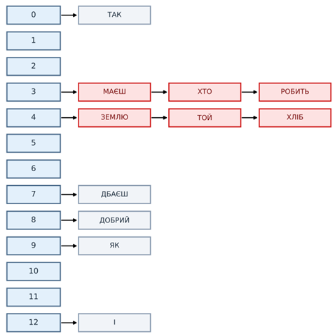

# Лабораторна робота № 4 — Робота з хеш-таблицями

## Варіант 22

Вхідні дані: послідовність слів

> Як дбаєш, так і маєш: хто землю робить, той хліб добрий робить

Послідовність містить 12 слів, з них 11 унікальних (слово «РОБИТЬ» повторюється і вдруге не вставляється).

Числовий ключ слова `K` — сума порядкових номерів його літер в українському алфавіті (А = 1, …, Я = 33).
Хеш-функції:

- метод ділення: `h(K) = K mod 13`
- метод множення: `h(K) = ⌊16 · (K·A mod 1)⌋`, `A ≈ 0,6180339887`

| Слово | ЯК | ДБАЄШ | ТАК | І | МАЄШ | ХТО | ЗЕМЛЮ | РОБИТЬ | ТОЙ | ХЛІБ | ДОБРИЙ |
|---|---|---|---|---|---|---|---|---|---|---|---|
| K | 48 | 46 | 39 | 12 | 55 | 68 | 82 | 107 | 56 | 56 | 73 |
| K mod 13 | 9 | 7 | 0 | 12 | 3 | 3 | 4 | 3 | 4 | 4 | 8 |
| множення | 10 | 6 | 1 | 6 | 15 | 0 | 10 | 2 | 9 | 9 | 1 |



## Результат

Середня кількість порівнянь при успішному пошуку елемента:

| Хеш-таблиця | Середня кількість | Максимум | Елемент(и) з максимумом |
|---|---|---|---|
| Ланцюжки, ділення (m = 13) | 1,55 | 3 | РОБИТЬ, ХЛІБ |
| Ланцюжки, множення (m = 16) | **1,36** | 2 | І, ЗЕМЛЮ, ХЛІБ, ДОБРИЙ |
| Відкрита адресація, ділення (m = 13) | 2,64 | 7 | ХЛІБ |
| Відкрита адресація, множення (m = 16) | 1,64 | 4 | ХЛІБ |

Найефективнішим виявилося хешування з ланцюжками за методом множення. Відкрита адресація з лінійним пробуванням чутливіша до коефіцієнта заповнення через первинну кластеризацію.

## Структура репозиторію

| Файл | Опис | Відповідає у звіті |
|---|---|---|
| `open_hash.py` | Відкрите хешування з роздільними ланцюжками (методи ділення та множення) | Лістинг 4.1, таблиці 4.5, 4.6 |
| `closed_hash.py` | Закрите хешування з відкритою адресацією та лінійним пробуванням | Лістинг 4.2, таблиці 4.11, 4.12 |
| `images/alphabet.png` | Порядкові номери літер українського алфавіту | Рисунок 4.1 |
| `images/open_division.png` | Відкрита хеш-таблиця, метод ділення | Рисунок 4.2 |
| `images/open_multiplication.png` | Відкрита хеш-таблиця, метод множення | Рисунок 4.3 |
| `images/closed_division.png` | Хід побудови закритої хеш-таблиці, метод ділення | Рисунок 4.4 |
| `images/closed_multiplication.png` | Хід побудови закритої хеш-таблиці, метод множення | Рисунок 4.5 |
| `images/comparisons_chart.png` | Середня кількість порівнянь для чотирьох таблиць | Рисунок 4.6 |
| `ЛР4_22_АІ254.docx` | Звіт з лабораторної роботи | — |
| `ЛР4_22_АІ254.pdf` | Звіт у форматі PDF | — |

## Запуск

Потрібен Python 3, сторонні бібліотеки не потрібні.

```bash
python open_hash.py
python closed_hash.py
```

